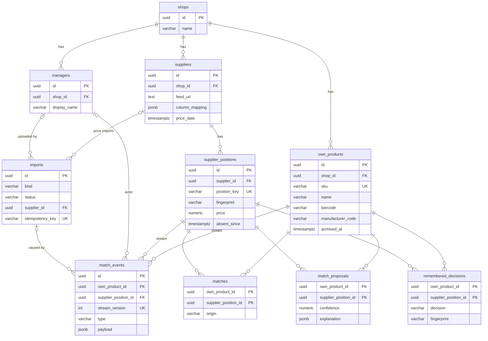

# Data model — product-matching

<!-- Stage 08+09 → .claude/skills/generate-data-model/SKILL.md. Migrations: /migrations/20261001120000..09 -->

> **Inputs:** [PRD](./PRD.md) §4–§6 · [SAD](./sad.md) §4, §6, §8 · ADR [0002](adr/0002-upload-own-catalog-via-manager-ui-with-shared-import-pipeline.md), [0003](adr/0003-run-imports-in-worker-process-with-postgres-job-queue.md), [0004](adr/0004-event-source-matches-and-decisions-with-inline-projections.md), [0005](adr/0005-upsert-supplier-positions-in-place-after-staging-validation.md), [0008](adr/0008-isolate-shops-by-shop-id-with-enforced-repository-filter.md)
> **Rules:** [.claude/rules/migrations.md](../../../.claude/rules/migrations.md) (baseline + project overrides)

Postgres 18. 10 таблиць у 5 агрегатах. Принципи: БД як «тупе сховище» (жодних `CHECK`, тригерів, бізнес-`DEFAULT`); UUID v7 генерується в app-шарі; `shop_id` у кожній таблиці + складені FK `(shop_id, x_id)` (ADR-0008); журнал `match_events` — джерело правди про зіставлення, три проєкції оновлюються в тій самій транзакції (ADR-0004).

## ER diagram

`shop_id` є в кожній таблиці, а кожен FK у діаграмі — складений `(shop_id, …)`. Для читабельності на діаграмі цього не показано.

## Aggregates

| Aggregate | Root | Members | Owner module (ADR-0007) |
|---|---|---|---|
| Shop (tenant) | `shops` | `managers` | `common` |
| Catalog | `own_products` | — | `catalog` |
| Supplier | `suppliers` | `supplier_positions` (upsert на місці, ADR-0005) | `suppliers`, `price-import` |
| Import | `imports` | — (staging — TEMP-таблиці сесії worker) | `file-intake`, `price-import`, `catalog` |
| Match ledger | `match_events` (stream = пара) | проєкції `matches`, `match_proposals`, `remembered_decisions` | `match-ledger` — єдиний писач |

## Entities

Для всіх таблиць діє однаковий шаблон: `id UUID PK` (UUID v7, генерується в app), `shop_id UUID NOT NULL REFERENCES shops(id)`, `UNIQUE (shop_id, id)` як ціль складених FK і `created_at TIMESTAMPTZ NOT NULL DEFAULT now()`. Нижче цей шаблон не повторюється. Виняток — проєкції (див. Match ledger). `updated_at` немає ніде (див. TBD-1).

Значення-переліки (`kind`, `status`, `origin`, `reason`, `decision`, `type`) — `VARCHAR` без `CHECK`. Допустимі значення живуть у TypeScript enum-ах модулів; тут вони наведені лише як документація.

### Shop

#### `shops`

| Column | Type | Constraints | Notes |
|---|---|---|---|
| `name` | VARCHAR(200) | NOT NULL | Створює оператор: самореєстрації в цій ітерації немає. `shop_id` на самій таблиці відсутній |

#### `managers`

| Column | Type | Constraints | Notes |
|---|---|---|---|
| `display_name` | VARCHAR(200) | NOT NULL | Ім'я в історії (AC-14). Email і спосіб ідентифікації — OQ SAD §11 (TBD-3) |

Системний актор (автозіставлення, фід за розкладом) у таблиці не зберігається: це `manager_id IS NULL` у `imports` і `match_events`.

### Catalog

#### `own_products`

| Column | Type | Constraints | Notes |
|---|---|---|---|
| `sku` | VARCHAR(100) | NOT NULL, UNIQUE (shop_id, sku) | Власний артикул магазину — ключ upsert при повторному завантаженні каталогу (ADR-0002). У розмітці каталогу це обов'язкова колонка (TBD-4) |
| `name` | VARCHAR(500) | NOT NULL | |
| `barcode` | VARCHAR(32) | NULL | Нормалізований штрихкод (лише цифри). Надійний код для каскаду (a) |
| `manufacturer_code` | VARCHAR(100) | NULL | Нормалізований артикул виробника (upper, без пробілів і дефісів). Надійний код для каскаду (a) |
| `brand` | VARCHAR(200) | NULL | Копіюється в `match_proposals` для фільтра черги |
| `category` | VARCHAR(500) | NULL | Шлях категорії магазину. Копіюється в `match_proposals` |
| `archived_at` | TIMESTAMPTZ | NULL | Товар зник із повторного каталогу. Зіставлення зберігаються, з черги товар прибирається (SAD §11 default, TBD-2). Це доменний стан, а не soft-delete |

**Access patterns:** каскад (a) за кодом → `idx_own_products_shop_id_barcode`, `idx_own_products_shop_id_manufacturer_code`; upsert каталогу → `uq_own_products_shop_id_sku`; готовність каталогу US-01 (COUNT по `shop_id`, ≤ 50 000 рядків) → префікс `uq_own_products_shop_id_sku`.

### Supplier

#### `suppliers`

| Column | Type | Constraints | Notes |
|---|---|---|---|
| `name` | VARCHAR(200) | NOT NULL | |
| `feed_url` | TEXT | NULL | URL фіду (SAD §3). NULL — лише завантаження файлом |
| `column_mapping` | JSONB | NULL | Запам'ятована схема колонок (AC-02, AC-04): заголовки + роль кожної колонки. **JSONB:** структура читається й пишеться цілою, за нею не фільтрують, і її форма залежить від формату файлу |
| `price_date` | TIMESTAMPTZ | NULL | Дата чинного прайсу. Фіксується останньою пачкою upsert (ADR-0005). Від неї рахується застарілість > 7 днів (AC-18) |

Той самий реальний постачальник у двох магазинах — це два рядки, тож ізоляція рішень (AC-12) структурна. Cron фідів (`WHERE feed_url IS NOT NULL`) сканує таблицю: ≤ 10 рядків на магазин, індекс не потрібен.

#### `supplier_positions`

| Column | Type | Constraints | Notes |
|---|---|---|---|
| `supplier_id` | UUID | NOT NULL, FK (shop_id, supplier_id) → suppliers | |
| `position_key` | VARCHAR(128) | NOT NULL, UNIQUE (shop_id, supplier_id, position_key) | Ключ позиції: код постачальника або SHA-256 нормалізованої назви, якщо коду немає (ADR-0005) |
| `supplier_code` | VARCHAR(100) | NULL | Код позиції в постачальника |
| `name` | VARCHAR(500) | NOT NULL | |
| `fingerprint` | VARCHAR(64) | NOT NULL | Відбиток позиції: SHA-256 hex від (код постачальника + нормалізована назва), default PRD §8. Порівнюється з `remembered_decisions.fingerprint` (AC-10, AC-11) |
| `barcode` | VARCHAR(32) | NULL | Нормалізований, як у `own_products` |
| `manufacturer_code` | VARCHAR(100) | NULL | Нормалізований, як у `own_products` |
| `brand` | VARCHAR(200) | NULL | Для пояснення пропозиції (бренд збігся / ні) |
| `price` | NUMERIC(14,4) | NOT NULL | Закупівельна ціна. Нечисловий рядок відхиляє весь прайс ще на staging (AC-03). Валюта й ПДВ не моделюються (PRD §8, TBD-5) |
| `in_stock` | BOOLEAN | NULL | Наявність. Формат у реальних прайсах невідомий (TBD-5) |
| `stock_quantity` | INTEGER | NULL | Кількість, якщо постачальник її дає (TBD-5) |
| `absent_since` | TIMESTAMPTZ | NULL | Позиції немає в останньому прайсі (AC-17). Знімається, коли позиція повертається. Рядки ніколи не видаляються |

**Access patterns:** upsert пачками по 5 000 рядків → `uq_supplier_positions_shop_id_supplier_id_position_key`; offers US-08 join за PK. Масштаб: ≈ 1 млн рядків на магазин (SAD §7).

### Import

#### `imports`

| Column | Type | Constraints | Notes |
|---|---|---|---|
| `kind` | VARCHAR(16) | NOT NULL | `catalog` \| `price` (спільний конвеєр, ADR-0002) |
| `source` | VARCHAR(16) | NOT NULL | `upload` \| `feed` |
| `status` | VARCHAR(32) | NOT NULL | `queued` → `processing` → `applied` \| `rejected` \| `awaiting_mapping` (flow 1, 2) |
| `supplier_id` | UUID | NULL, FK (shop_id, supplier_id) → suppliers | NULL для `kind = catalog` |
| `manager_id` | UUID | NULL, FK (shop_id, manager_id) → managers | Хто завантажив. NULL — система (фід за розкладом) |
| `idempotency_key` | VARCHAR(200) | NULL, UNIQUE (shop_id, idempotency_key) | Фід: `supplier_id + дата` або `supplier_id + request_id` (US-02, повтор задачі після рестарту) |
| `storage_key` | VARCHAR(1024) | NULL | Ключ об'єкта в S3 (ADR-0006, lifecycle 30 днів). NULL, якщо фід відхилено до збереження файлу (SSRF, розмір) |
| `original_filename` | VARCHAR(255) | NULL | |
| `column_mapping` | JSONB | NULL | Розмітка, з якою розбирався саме цей файл (для каталогу — єдине місце її зберігання). **JSONB:** та сама структура, що й `suppliers.column_mapping` |
| `issues` | JSONB | NULL | Звіт для UI: некоректні колонки й рядки (AC-03, обрізаний до перших N) або відмінності схеми (AC-04), причина відмови фіду. **JSONB:** форма залежить від `status`, за полями не фільтрують |
| `rows_recognized` | INTEGER | NULL | «N позицій розпізнано» (AC-02) |
| `auto_matched_count` | INTEGER | NULL | «M автозіставлено» |
| `proposals_count` | INTEGER | NULL | «K пропозицій у черзі» |
| `started_at` | TIMESTAMPTZ | NULL | worker узяв задачу |
| `finished_at` | TIMESTAMPTZ | NULL | Кінцевий статус (applied, rejected, awaiting_mapping). `price_import.processing_duration` = `finished_at − created_at` для `status = applied` (SAD §10 QG-2 називає це `applied_at`) |

**Access patterns:** список імпортів магазину й ліміт 30/год (`COUNT … WHERE shop_id AND created_at > now() - 1h`) → `idx_imports_shop_id_created_at`; імпорти постачальника → `idx_imports_shop_id_supplier_id`. Задача pg-boss створюється в тій самій транзакції. Таблиці pg-boss (схема `pgboss`) мігрує сам pg-boss.

### Match ledger

#### `match_events` — журнал (джерело правди)

| Column | Type | Constraints | Notes |
|---|---|---|---|
| `own_product_id` | UUID | NOT NULL, FK → own_products | Потік = пара `(shop_id, own_product_id, supplier_position_id)`. Окремого `stream_id` немає (відхід від формулювання SAD §4, той самий зміст) |
| `supplier_position_id` | UUID | NOT NULL, FK → supplier_positions | |
| `stream_version` | INTEGER | NOT NULL, UNIQUE (shop_id, own_product_id, supplier_position_id, stream_version) | Оптимістична конкурентність: друге рішення з тією самою версією → unique violation → 409 (flow 3) |
| `type` | VARCHAR(64) | NOT NULL | `AutoMatched`, `ProposalCreated`, `ProposalConfirmed`, `ProposalRejected`, `MatchCancelled`, `ReturnedToQueue`, … (каталог подій — у модулі `match-ledger`) |
| `schema_version` | SMALLINT | NOT NULL | Версія схеми payload. Старі версії перетворюють upcaster-и (SAD §8) |
| `manager_id` | UUID | NULL, FK → managers | NULL — система (автозіставлення з поясненням, AC-14) |
| `import_id` | UUID | NULL, FK → imports | Імпорт, що спричинив подію. NULL для рішень менеджера |
| `payload` | JSONB | NOT NULL | Тіло події: пояснення (код збігу, що змінилось у відбитку, впевненість). **JSONB:** форма своя для кожного `type`/`schema_version`. Це класичний payload подій |

Таблиця append-only, рядки не оновлюються й не видаляються. Подія пишеться лише при зміні стану пари (ADR-0004). Історія власного товару AC-14 читається через префікс `uq_match_events_stream_version` (shop_id, own_product_id), а сортування за часом відбувається в пам'яті: подій на товар одиниці.

#### Проєкції

Спільне для трьох: PK — це потік `(shop_id, own_product_id, supplier_position_id)`, а не UUID. Замість `created_at` кожна має доменний час, узятий з події (`matched_at`, `proposed_at`, `decided_at`), бо перебудова з журналу переписує рядки. `stream_version` повертається в UI, і з ним приходить наступне рішення. Складені FK на `own_products` і `supplier_positions` фізично не дають зв'язати рядки різних магазинів. Рядки проєкцій видаляються (DELETE) при зміні стану. Це не порушує правила «hard delete + audit»: історія живе в `match_events`.

#### `matches` (SAD: `match_view`)

| Column | Type | Constraints | Notes |
|---|---|---|---|
| `origin` | VARCHAR(32) | NOT NULL | `auto_code` \| `auto_remembered` \| `confirmed` |
| `stream_version` | INTEGER | NOT NULL | |
| `matched_at` | TIMESTAMPTZ | NOT NULL | |

Єдине джерело закупівельної ціни й наявності (інваріант CONTEXT, AC-16). Пару, повернуту в чергу (AC-11), і скасовану пару (AC-13) прибирають звідси. Покриття US-07: `COUNT(DISTINCT own_product_id)` через префікс PK.

#### `match_proposals` (SAD: `proposal_queue_view`)

| Column | Type | Constraints | Notes |
|---|---|---|---|
| `reason` | VARCHAR(32) | NOT NULL | `ambiguous_code` (AC-07) \| `similar` (AC-06) \| `fingerprint_changed` (AC-11) |
| `confidence` | NUMERIC(4,3) | NOT NULL | 0.000–1.000; сортування черги (AC-08). Поріг «низької впевненості» — у коді (PRD §8) |
| `explanation` | JSONB | NOT NULL | Які ознаки збіглися / ні, що змінилось. **JSONB:** склад ознак залежить від `reason` і механізму стадії (c) (OQ SAD §11) |
| `brand` | VARCHAR(200) | NULL | Копія `own_products.brand` для фільтра й масового підтвердження (AC-09) |
| `category` | VARCHAR(500) | NULL | Копія `own_products.category` (US-04) |
| `stream_version` | INTEGER | NOT NULL | Масове рішення передає версії. Вирішені іншим пропускаються (flow 4) |
| `proposed_at` | TIMESTAMPTZ | NOT NULL | |

#### `remembered_decisions` (SAD: `remembered_decision_view`)

| Column | Type | Constraints | Notes |
|---|---|---|---|
| `decision` | VARCHAR(16) | NOT NULL | `confirmed` \| `rejected`. Скасування (AC-13) записується як `rejected` (семантика — TBD-6) |
| `fingerprint` | VARCHAR(64) | NOT NULL | Відбиток позиції на момент рішення. Каскад (b) застосовує рішення, лише поки він збігається з `supplier_positions.fingerprint` |
| `stream_version` | INTEGER | NOT NULL | |
| `decided_at` | TIMESTAMPTZ | NOT NULL | |

Каскад (a) теж читає цю таблицю (PK-lookup пари), щоб відхилену чи скасовану пару не створити знову за кодом (gap 1 з `_audit/sequences-2026-10-01.md`).

## Indexes

PK і `UNIQUE (shop_id, id)` на кожній таблиці тут не перелічено: це ціль складених FK (ADR-0008). Кожен FK покритий індексом, у якого провідні колонки — рівно колонки FK. Це перевірено за `pg_index` на Postgres 18.6.

| Index | Columns | Query it serves |
|---|---|---|
| `uq_own_products_shop_id_sku` | (shop_id, sku) UNIQUE | Upsert каталогу (ADR-0002); COUNT готовності US-01 |
| `idx_own_products_shop_id_barcode` | (shop_id, barcode) WHERE barcode IS NOT NULL | Каскад (a): штрихкод → власний товар(и) (AC-05, AC-07) |
| `idx_own_products_shop_id_manufacturer_code` | (shop_id, manufacturer_code) WHERE … IS NOT NULL | Каскад (a): артикул виробника → власний товар(и) |
| `uq_imports_shop_id_idempotency_key` | (shop_id, idempotency_key) UNIQUE | US-02 фід: «імпорт з цим key вже є?» |
| `idx_imports_shop_id_created_at` | (shop_id, created_at DESC) | Список імпортів; ліміт 30 завантажень/год (PRD §6.1) |
| `idx_imports_shop_id_supplier_id` | (shop_id, supplier_id, created_at DESC) WHERE supplier_id IS NOT NULL | Імпорти постачальника; FK-індекс |
| `idx_imports_shop_id_manager_id` | (shop_id, manager_id) WHERE manager_id IS NOT NULL | Лише FK-індекс (правило) |
| `uq_supplier_positions_shop_id_supplier_id_position_key` | (shop_id, supplier_id, position_key) UNIQUE | Upsert позицій (ADR-0005); FK-індекс на suppliers |
| `uq_match_events_stream_version` | (shop_id, own_product_id, supplier_position_id, stream_version) UNIQUE | Конкурентні рішення → 409 (flow 3); історія товару (US-06); FK-індекс на own_products |
| `idx_match_events_shop_id_supplier_position_id` | (shop_id, supplier_position_id) | FK-індекс; історія позиції |
| `idx_match_events_shop_id_manager_id` | (shop_id, manager_id) WHERE manager_id IS NOT NULL | FK-індекс. Partial, бо системні події (≈ 100k на імпорт) його не навантажують |
| `idx_match_events_shop_id_import_id` | (shop_id, import_id) WHERE import_id IS NOT NULL | Вибірка автозіставлень імпорту для аудиту точності 200 шт. (PRD §6); FK-індекс |
| `idx_matches_shop_id_supplier_position_id` | (shop_id, supplier_position_id) | AC-11: зіставлення позиції зі зміненим відбитком; FK-індекс |
| `idx_match_proposals_shop_id_confidence` | (shop_id, confidence DESC, own_product_id, supplier_position_id) | Сторінка черги 50 шт., keyset (AC-08, QG-3 p95 ≤ 1 с) |
| `idx_match_proposals_shop_id_brand_confidence` | (shop_id, brand, confidence DESC) | Фільтр за брендом + попередній перегляд масового підтвердження з лічильником низької впевненості (AC-09, flow 4) |
| `idx_match_proposals_shop_id_category_confidence` | (shop_id, category, confidence DESC) | Фільтр за категорією (US-04) |
| `idx_match_proposals_shop_id_supplier_position_id` | (shop_id, supplier_position_id) | Каскад при повторному імпорті: прибрати / оновити пропозиції позиції; FK-індекс |
| `idx_remembered_decisions_shop_id_supplier_position_id` | (shop_id, supplier_position_id) | Каскад (b): рішення для позицій імпорту (AC-10); FK-індекс |

**Свідомо не створено:** індекс для пошуку схожих за назвою (`pg_trgm` GIN на `name`) — механізм стадії (c) ще OQ (SAD §11, due 2026-10-15), і індекс додасться окремою міграцією після спайку. Партиціонування `supplier_positions` / `match_events` поза межами (SAD §7 пороги, rules → Out of scope).

## Seeds

Немає. Lookup-таблиць немає, бо переліки живуть у коді. Bootstrap-магазин свідомо не сідиться в міграціях: він потрапив би в прод, а пілотні магазини створює оператор (TBD-3).

## Test fixtures

Factory-функції — у `src/testing/fixtures/` (TS-еквівалент Go-фабрик зі skill). Їх пишуть разом зі скелетом NestJS-проєкту: зараз у репо немає `src/` і `package.json`. Контракт:

| Factory | Створює | Defaults |
|---|---|---|
| `createShop(ds, opts?)` | `shops` | `name: 'Test Shop'` |
| `createManager(ds, shop, opts?)` | `managers` | `display_name: 'Test User'` |
| `createOwnProduct(ds, shop, opts?)` | `own_products` | `sku: 'SKU-<uuid8>'`, `name: 'Test Product <n>'`, коди NULL |
| `createSupplier(ds, shop, opts?)` | `suppliers` | `name: 'Test Supplier'`, без фіду |
| `createSupplierPosition(ds, supplier, opts?)` | `supplier_positions` | `position_key` = `supplier_code` = `'SUP-<n>'`, `price: 100`, `fingerprint` з коду + назви |
| `appendMatchEvent(ds, …)` | через сервіс `match-ledger`, не прямим INSERT | — щоб проєкції лишались узгодженими |

PII guard: лише `Test User`, `Test Shop`, `@example.test`, без реальних імен і email.

## Open items (TBD)

1. <!-- TBD: updated_at --> Таблиці зі станом, що змінюється на місці (`own_products`, `suppliers`, `supplier_positions`, `imports`), не мають `updated_at` (immutable-first default). Чи потрібен він для діагностики upsert? — owner: Backend Lead.
2. <!-- TBD: archived --> `archived_at` для власних товарів, що зникли з повторного каталогу. Це default SAD §11, який треба підтвердити з PM. — owner: gene.bilyy@gmail.com.
3. <!-- TBD: identity --> `managers` має лише `display_name`. Email, зв'язок з ідентифікацією й створення магазину/менеджера залежать від OQ SAD §11 (джерело RequestContext). — owner: gene.bilyy@gmail.com + Security Lead, до старту пілоту.
4. <!-- TBD: own sku --> `own_products.sku` NOT NULL. Розмітка каталогу (SAD US-01: назва, штрихкод, артикул виробника) має отримати обов'язкову колонку «артикул магазину», інакше upsert і архівування неможливі. — owner: gene.bilyy@gmail.com.
5. <!-- TBD: price/availability format --> `price NUMERIC(14,4)` без валюти/ПДВ і пара `in_stock` / `stock_quantity` — перевірити на 2–3 реальних прайсах (PRD §8, due 2026-10-15). Довжини VARCHAR — інженерна оцінка, у PRD меж немає.
6. <!-- TBD: cancel semantics --> Скасування = `remembered_decisions.decision = 'rejected'` з поточним відбитком (sequences audit gap 2). Схема підтримує й альтернативу — видалити рядок і повернути пару в чергу. — owner: PM.
