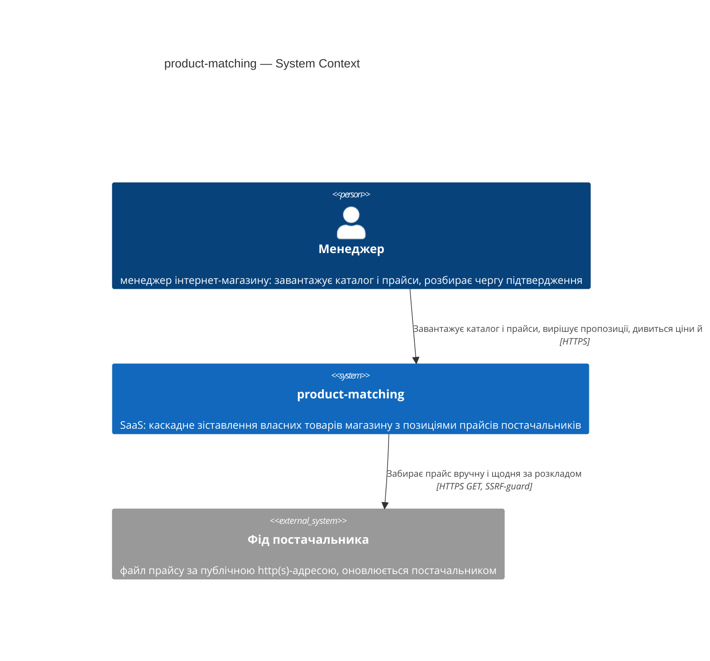
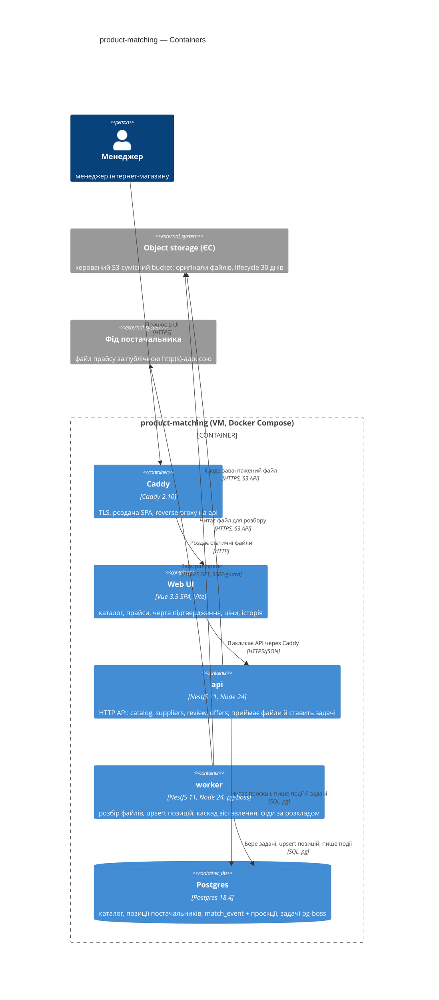
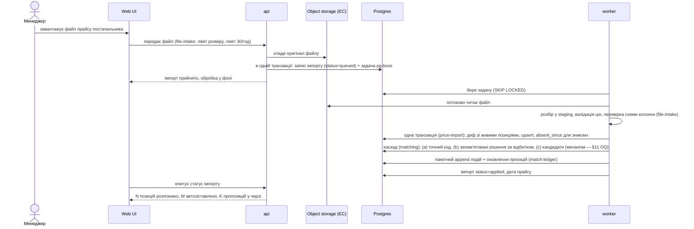
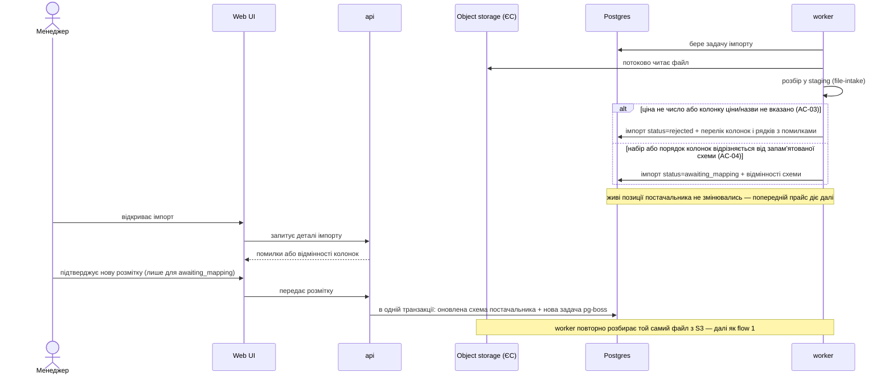
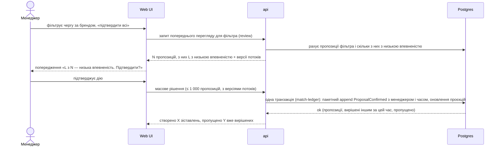

# Software Architecture Document — product-matching

<!-- Stages 04-05 → see sdlc/plugin/skills/architecture-design/SKILL.md -->
<!-- 12 Arc42 sections. Empty sections — <!-- N/A: <one-line reason> -->. -->
<!-- C4 Context (L1) lives inline in §3. C4 Container (L2) lives inline in §5. -->
<!-- Заповнений приклад: див examples/course-lesson-mvp/sad.md у sdlc/ toolkit. -->

## 1. Introduction and goals

**Intent.** product-matching — окремий SaaS-застосунок для українських інтернет-магазинів (каталог 5–50 тис. власних товарів, 3+ постачальників), який каскадно зіставляє власні товари магазину з позиціями прайсів постачальників: автоматичне зіставлення за надійним кодом (штрихкод, артикул виробника) або запам'ятованим рішенням менеджера, решта — черга підтвердження з поясненням. Менеджер бачить актуальну закупівельну ціну й наявність кожного власного товару без ручного зведення прайсів; кожне рішення запам'ятовується, будь-яке зіставлення простежується в історії й скасовується (PRD §2, §1).

**Top-3 quality goals (1-liners; full scenarios in §10):**

1. **QG-1 Коректність зіставлення** — ціна й наявність лише через зіставлення (інваріант CONTEXT); хибних автоматичних зіставлень ≤ 1%; з конкурентних рішень застосовується лише перше.
2. **QG-2 Продуктивність обробки прайсу** — прайс ≤ 50 000 рядків (розбір + автозіставлення + підготовка черги) p95 ≤ 10 хв при масштабі 50 000 власних товарів, 10 постачальників, прайс ≤ 100 000 рядків.
3. **QG-3 Чуйність черги підтвердження** — сторінка черги (50 пропозицій) p95 ≤ 1 с; рішення p95 ≤ 300 мс; масове підтвердження ≤ 1 000 пропозицій p95 ≤ 10 с.

**Stakeholders.**

| Role | Interest | Sign-off owner? |
|---|---|---|
| Менеджер | завантажує прайси, розбирає чергу підтвердження, бачить ціну й наявність | No |
| Пілотний магазин | власник конфіденційних даних; ізоляція своїх рішень (AC-12) | No |
| Автор / PM (gene.bilyy@gmail.com) | KPI з PRD §7; консультує §10 і серйозність ризиків §11 | No (consulted) |
| Tech Lead | затвердження SAD | Yes |
| Security Lead | security review (PRD §6.1: Required) | Yes |

Decision overrides:

- _(none yet — populated by Step 8 critic `Override` resolutions)_

## 2. Constraints

**Technical.**
- TypeScript 5.7 на Node.js 24.18 (LTS) — ADR-0001.
- Backend: NestJS 11 + TypeORM + `pg` 8; розбір прайсів — потокові Node-бібліотеки (exceljs streaming reader, csv-parse).
- Datastore: Postgres 18.4 — єдине сховище (включно з чергою фонових задач і пошуком схожих — див. §4).
- Frontend: Vue 3.5 SPA (Vite), як `schemka-front`.
- Доставка: Docker Compose + Caddy 2.10 на одній VM, як `price-infrastructure`.
- Архітектурна конвенція: feature-модулі NestJS, шари `controllers → services → repositories → entity` (як `schemka-backend`).

**Organisational.**
- Бюджет: 4 людино-тижні, розмір M (PRD frontmatter; idea-brief §11). Запасу в графіку немає (idea-brief §12).
- Жорсткий дедлайн пілоту: `<TBD by PM>` — див. §11.
- Реальні прайси 2–3 пілотних магазинів — до 2026-10-15 (PRD §8); на них калібруються розбір і поріг «низької впевненості».

**Conventions.**
- У цьому репо CLAUDE.md ще немає. Референсна конвенція — `../schemka/schemka-backend/CLAUDE.md`: feature-модулі в `src/modules/<feature>/`, міграції TypeORM CLI, Swagger на `/docs`. Код s-price не перевикористовується (окремий застосунок, idea-brief §15) — копіюється лише форма.

**Regulatory / external.**
- Дані confidential (комерційна таємниця магазинів і постачальників); персональні дані — лише ім'я/email менеджера в історії (PRD §6.1).
- Автентифікація й авторизація — поза межами ітерації (PRD §3, §1 overrides); обов'язкові лише ізоляція рішень магазину (AC-12) і розрізнення менеджерів (AC-14).
- Обов'язкові контролі PRD §6.1: SSRF-захист фіду (лише публічні http(s), без приватних мереж і метаданих хмари, таймаут, ліміт розміру), ліміт розміру файлу й рядків, захист від архівних бомб, формули не виконуються, ≤ 30 завантажень прайсів на магазин на годину.

## 3. Context and scope

<!-- brownfield: N/A — greenfield repo -->

Менеджер інтернет-магазину завантажує у product-matching власний каталог і прайси постачальників (файлом або посиланням на фід), розбирає чергу підтвердження і бачить закупівельну ціну й наявність кожного власного товару. Фіди постачальників — зовнішнє недовірене джерело: **кордон довіри** проходить по кожному вхідному файлу й URL (SSRF-захист, ліміти, формули не виконуються). Інтеграцій із платформами магазинів і з вітриною немає (PRD §3: автоматична зміна цін — non-goal).

**External systems (in / out):**

| Actor or system | Type | Interaction |
|---|---|---|
| Менеджер | Person | Завантажує власний каталог (ADR-0002) і прайси, підтверджує розмітку колонок, підтверджує/відхиляє пропозиції зіставлення, скасовує зіставлення, переглядає історію, ціни й наявність |
| Фід постачальника | System (external, untrusted) | Система завантажує файл за публічною http(s)-адресою — за кнопкою «Оновити зараз» і за розкладом раз на добу; SSRF-захист, таймаут, ліміт розміру (PRD §6.1) |

**Feed refresh (inline decision):** фід забирається вручну (кнопка менеджера) і автоматично раз на добу для кожного постачальника з фідом. Запланований запуск рахується в ліміт 30 завантажень/магазин/год. Якщо нічний фід змінив набір/порядок колонок (AC-04), прайс не застосовується, попередній діє далі, а менеджер бачить у UI попередження «потрібно підтвердити розмітку».

**C4 Context (L1):**



## 4. Solution strategy

**Top-3 strategic choices (the seeds for ADRs):**

1. **Фонова обробка у worker-процесі з чергою задач у Postgres** (ADR-0003) — один образ NestJS запускається як `api` (лише HTTP) і `worker` (розбір прайсів і каталогу, каскад зіставлення, забирання фідів за розкладом). Задачі зберігаються в Postgres через pg-boss і створюються в тій самій транзакції, що й запис про імпорт. Розбір 100k рядків триває хвилини й не має блокувати HTTP: QG-2 (p95 ≤ 10 хв) і QG-3 (черга p95 ≤ 1 с під час імпорту).
2. **Каскад зіставлення у worker** — стадії виконуються послідовно на кожен імпорт: (a) точний нормалізований код (штрихкод / артикул виробника) — єдиний власний товар → автоматичне зіставлення, кілька → пропозиції з поясненням «код неоднозначний» (AC-05, AC-07); (b) запам'ятовані рішення за відбитком позиції — код постачальника + нормалізована назва (AC-10, AC-11; default з PRD §8); (c) пошук кандидатів за схожістю → пропозиції з впевненістю й поясненням (AC-06, AC-08). **Механізм стадії (c) — відкрите рішення в §11** (owner gene.bilyy@gmail.com, due 2026-10-15). Інваріант для всіх стадій: схожість сама по собі зіставлення не створює.
3. **Позиції постачальника оновлюються на місці** (ADR-0005) — одна таблиця позицій на постачальника з ключем позиції (код постачальника, або хеш нормалізованої назви, якщо коду немає). Новий прайс спершу повністю розбирається у тимчасову staging-таблицю worker-сесії й валідується (AC-03 ціни, AC-04 схема колонок); живі рядки не торкаються, доки валідація не пройшла — так «попередній прайс діє далі». Потім одна транзакція: обчислює відмінності (змінились код/назва → AC-11, позиції немає → `absent_since`, AC-17), робить upsert і фіксує дату прайсу.
4. **Повний event sourcing для зіставлень і рішень** (ADR-0004) — джерело правди — append-only журнал `match_event` (потік на пару «власний товар ↔ позиція постачальника» в межах магазину). Конкурентність — оптимістична: унікальність (stream_id, stream_version) — друге рішення по тій самій версії отримує конфлікт → 409 «вже вирішено» (PRD §6). Проєкції (`match_view`, `proposal_queue_view`, `remembered_decision_view`) оновлюються синхронно в тій самій транзакції, що й запис події, тож читання черги й цін — прості SELECT (QG-3), а інваріант CONTEXT перевіряється на проєкції `match_view`. Історія AC-13/AC-14 — це сам журнал.

Each tactical decision in later sections should be traceable to one of these strategic seeds. Tactical decisions that *contradict* a strategic choice are red flags — surface them in §11 Risks.

## 5. Building block view

Модульний моноліт NestJS із шарами s-price (`controllers → services → repositories → entity`): одна кодова база, два режими запуску — `api` і `worker` (ADR-0003). Модулі спілкуються прямими викликами експортованих сервісів, без брокера подій. Межі зафіксовано в ADR-0007; ключове правило — **писати в журнал подій зіставлень (ADR-0004) можна лише через сервіс `match-ledger`**, тож подія і оновлення проєкцій завжди йдуть однією транзакцією. Оригінали завантажених файлів зберігаються в керованому S3-сумісному bucket у ЄС із видаленням через 30 днів (ADR-0006).

**Internal decomposition:**

```
src/
├── modules/
│   ├── catalog/        власні товари: завантаження каталогу (ADR-0002), готовність каталогу (US-01)
│   ├── suppliers/      постачальники, схема колонок, URL фіду + розклад
│   ├── file-intake/    спільний конвеєр: upload / fetch (SSRF-guard), ліміти, потоковий розбір XLSX/CSV, staging, валідація
│   ├── price-import/   імпорт прайсу постачальника: staging → диф → upsert (ADR-0005) → запуск каскаду
│   ├── matching/       каскад a/b/c (§4) → події через match-ledger
│   ├── match-ledger/   event store + inline-проєкції + історія (ADR-0004)
│   ├── review/         черга підтвердження: список, рішення одне/масове, скасування, попередження про низьку впевненість
│   └── offers/         ціна й наявність на власний товар, застарілість (AC-18), покриття (US-07)
├── infrastructure/     database (TypeORM), jobs (pg-boss), storage (S3 client)
└── common/             контекст магазину (§8), помилки, логування
```

**C4 Container (L2):**



## 6. Runtime view

Учасники — контейнери з §5 (у дужках — модуль NestJS, що виконує крок). Повідомлення семантичні; ендпоінт-рівень — на stage api-forge. Скасування зіставлення (AC-13) та інші потоки домальовує `sdlc:complete-sequence-diagrams`.

**Critical flow 1: Імпорт прайсу + каскад зіставлення (happy path; US-02, US-03, US-05, AC-02, AC-05, AC-07, AC-10, AC-11, AC-17)**



**Critical flow 2: Відхилений імпорт — некоректні ціни або змінена схема колонок (failure; AC-03, AC-04)**



**Critical flow 3: Рішення по пропозиції при конкурентному доступі (PRD §6 «Конкурентні рішення»; AC-08)**

```mermaid
sequenceDiagram
    actor M1 as Менеджер A
    actor M2 as Менеджер B
    participant API as api
    participant PG as Postgres
    M1->>API: підтверджує пропозицію P (бачив версію потоку v)
    M2->>API: відхиляє пропозицію P (бачив версію потоку v)
    API->>PG: транзакція A (review → match-ledger): append ProposalConfirmed з stream_version=v+1, оновлення проєкцій
    API->>PG: транзакція B: append ProposalRejected з stream_version=v+1
    PG-->>API: A — ok
    PG-->>API: B — порушення унікальності (stream_id, stream_version)
    API-->>M1: зіставлення створено; ціна й наявність з позиції застосовані
    API-->>M2: 409 — пропозицію вже вирішено (підтвердив Менеджер A)
```

**Critical flow 4: Масове підтвердження з попередженням про низьку впевненість (AC-09)**



## 7. Deployment view

<!-- 🎯 Навіщо: ТОПОЛОГІЯ, яку DevOps має знати без читання Helm-чартів — скільки реплік,  -->
<!--           де живе фоновий обробник, ПРИ ЯКИХ ЧИСЛАХ масштабуємось.                     -->
<!-- 📋 Що писати: 2-3 речення про топологію + метрики + алерти + конкретні числа-пороги.   -->
<!-- 📌 Приклад: «500 IC → партиціонування за кварталом» (не «при зростанні подумаємо»).    -->
<!-- 🎯 Можна N/A для XS/S функцій, що переюзають існуюче розгортання без змін.            -->

<Topology in 2-3 sentences. Where it runs (k8s / VM / serverless), replicas, scaling thresholds.>

**Monitoring:**
- <Metrics — e.g. Prometheus `<metric_name>`>
- <Alerts — e.g. "outbox lag > 10 min → page on-call">
- <Tracing — e.g. OpenTelemetry HTTP spans>

**Scaling thresholds:**
- <e.g. 500 IC × 5 goals × 26 checkpoints/Q = 65k rows/year — comfortable in one table>
- <e.g. partitioning by quarter at >500k rows/year>

<!-- For XS/S that doesn't change deployment: <!-- N/A: feature reuses existing deployment unit -->. -->

## 8. Crosscutting concepts

<!-- 🎯 Навіщо: НАСКРІЗНІ ПАТЕРНИ, які перетинають кілька модулів: логування, помилки,    -->
<!--           авторизація, ID strategy, outbox, кеш. ⭐ Друга найгустіша секція.          -->
<!--           Якщо патерн всередині одного модуля — він НЕ сюди. Якщо це конвенція        -->
<!--           проєкту в цілому — у CLAUDE.md.                                              -->
<!-- 📋 Що писати: таблиця концепт / конвенція / де визначено. Один рядок на концепт.      -->
<!-- 📌 Приклад: «UUID v7 (час+випадковий, сортується) у app-layer» — як default з CLAUDE.md. -->

| Concept | Convention | Where defined |
|---|---|---|
| Logging | <e.g. structured slog, fields `module=<name>`> | <CLAUDE.md §X or here> |
| Authentication | <e.g. JWT via session middleware> | <CLAUDE.md §X> |
| Error handling | <e.g. domain sentinel → ports/errors.go → apperr JSON> | <CLAUDE.md §X> |
| ID strategy | <e.g. UUID v7 in app layer> | <CLAUDE.md §X> |
| Internationalisation | <e.g. N/A, English only> | — |
| Observability | <e.g. OpenTelemetry on HTTP boundaries> | — |
| Outbox / events | <module-specific patterns, if any> | <here> |

## 9. Architecture decisions

<!-- 🎯 Навіщо: ЗВОРОТНИЙ ІНДЕКС на папку adr/. `ls adr/` дає файли, §9 дає семантику —    -->
<!--           чому вони існують, до якого зрізу SAD привʼязані, у якому статусі.           -->
<!-- 📋 Що писати: таблиця з 4 колонками. Один рядок на ADR. Mixed status — це OK.         -->
<!-- 📌 Приклад: «0001 | Зберігати урок як таблицю блоків | Accepted | §4».                -->

| # | Title | Status | Section |
|---|---|---|---|
| <NNNN> | <imperative — e.g. "Use sliding window for rate limiting"> | Accepted | §<N> |
| <NNNN> | <imperative — e.g. "Co-locate outbox worker in API process"> | Accepted | §<N> |

ADR files live under `docs/features/<slug>/adr/NNNN-<title>.md`.

## 10. Quality requirements

<!-- 🎯 Навіщо: ДЕРЕВО ЯКОСТЕЙ (Quality Tree) — беремо мету з §1 і розкладаємо на          -->
<!--           конкретні листя: тести, метрики, конфіги, drill-и. ⭐ Без §10 §1 — це       -->
<!--           маніфест. З §10 кожна декларація мапиться на щось, ЩО МОЖНА ДОВЕСТИ.        -->
<!-- 📋 Що писати: на кожну якість з §1 — When / Then / How verify. Числа з PRD §6 NFR     -->
<!--           ДОСЛІВНО (не округлюй p95 ≤250мс до ≤300мс — це F6-помилка критика).        -->
<!-- 📌 Приклад: «p95 ≤500 мс на UPDATE блоку, перевіримо k6 load test 100 req/s».        -->

Each top-3 goal from §1 expanded into a full scenario:

**QG-1. <quality attribute>**
- **When:** <trigger condition>
- **Then:** <expected behavior with numbers from PRD NFR>
- **How verify:** <test / chaos drill / load test / observability>

**QG-2. <quality attribute>**
- **When:** <trigger>
- **Then:** <expected>
- **How verify:** <how>

**QG-3. <quality attribute>**
- **When:** <trigger>
- **Then:** <expected>
- **How verify:** <how>

## 11. Risks and technical debt

| Risk / debt | Severity | Mitigation | Owner |
|---|---|---|---|
| Open architectural decision: механізм пошуку кандидатів за схожістю (стадія (c) каскаду, §4.2) | Open question | Resolve before 2026-10-15; «Порівняти варіанти спайком: pg_trgm, пошук у пам'яті worker, ембедінги — за точністю і часом, перш ніж фіксувати» | gene.bilyy@gmail.com |

## 12. Glossary

<!-- 🎯 Навіщо: ⭐ СЛОВНИК ДОМЕНУ, який припиняє суперечки через рік («checkpoint —      -->
<!--           weekly чи biweekly? Quarter — календарний чи фіскальний?»).                -->
<!-- 📋 Що писати: таблиця термін / значення. Бізнес-терміни + технічні вперемішку.       -->
<!--           Один термін може мати дві мови у заголовку: «Goal (Обʼєктив)».              -->
<!-- 📌 Приклад: «Lesson | урок усередині курсу, що складається з блоків (text, video)». -->

| Term | Meaning |
|---|---|
| <e.g. Goal> | <quarterly intent in statement form> |
| <e.g. KR> | <Key Result — measurable target linked to a Goal> |
| <e.g. Checkpoint> | <bi-weekly progress update on a KR> |
