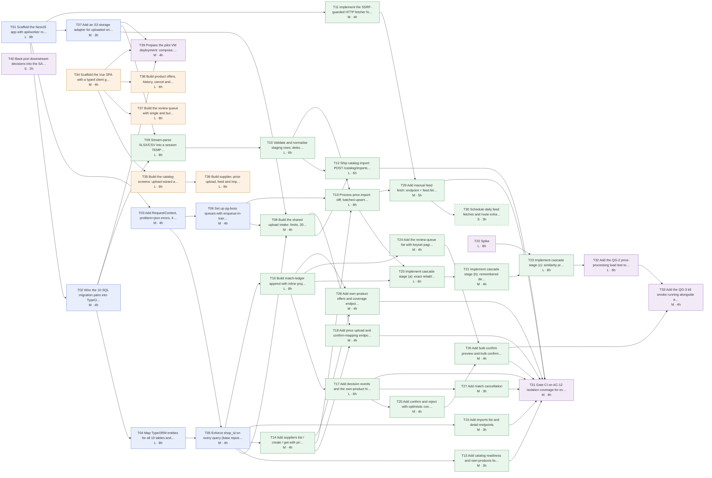

# Epic — product-matching

<!-- Stage 13 → .claude/skills/break-tasks/SKILL.md. One task = one Claude session = one PR. -->

Cascade matching of a shop's own products to supplier price positions: automatic by reliable code or remembered decision, the rest goes to a review queue with an explanation; price and availability come only through a match. This epic only links: the "what" lives upstream.

| Artefact | Use it for |
|---|---|
| [PRD](../PRD.md) | US-01…US-08, AC-01…AC-18, NFR §6, security §6.1 |
| [SAD](../sad.md) | §4 strategy, §5 modules, §6 flows, §7 deployment, §8 crosscutting, §10 QG scenarios, §11 risks / OQs |
| ADRs [0001](../adr/0001-use-s-price-stack-nestjs-postgres-vue.md) · [0002](../adr/0002-upload-own-catalog-via-manager-ui-with-shared-import-pipeline.md) · [0003](../adr/0003-run-imports-in-worker-process-with-postgres-job-queue.md) · [0004](../adr/0004-event-source-matches-and-decisions-with-inline-projections.md) · [0005](../adr/0005-upsert-supplier-positions-in-place-after-staging-validation.md) · [0006](../adr/0006-store-uploads-in-managed-eu-s3-bucket-with-30-day-lifecycle.md) · [0007](../adr/0007-split-monolith-into-eight-nest-modules-with-ledger-as-sole-event-writer.md) · [0008](../adr/0008-isolate-shops-by-shop-id-with-enforced-repository-filter.md) | All Accepted; constraints every task must respect |
| [data-model](../data-model.md) + [backend/migrations/](../../../../backend/migrations/) | Tables, indexes, TBD-1…6 |
| [openapi.yaml](../contracts/openapi.yaml) · [events.md](../contracts/events.md) · [api-sync-report](../contracts/api-sync-report.md) | Endpoint contract, jobs, ledger events, sentinel error codes, D-1…D-15 |

## Hard rules every task respects

- Only `match-ledger` writes `match_events` and the three projections, in one transaction (ADR-0004, ADR-0007).
- Every query is shop-scoped through the T05 repository or SQL helper; `shop_id` never appears in the API (ADR-0008).
- Price and availability are read only from `matches`; similarity never creates a match (CONTEXT invariant, AC-06, AC-16).
- Schema changes are new SQL pairs per [rules/migrations.md](../../../../.claude/rules/migrations.md), never `migration:generate`.
- Files and URLs enter only through `file-intake` (ADR-0007, PRD §6.1).

## Dependency graph

Lanes: blue = foundation, green = backend features, orange = UI (works against `prism mock` until the backend lands), purple = quality / ops / docs. Dashed = P1.

**Critical path** (longest chain by hours, unlimited people): T01 → T02 → T04 → T05 → T14 → T19 → T20 → T21 → T23 → T32 → T33 = 64 h ≈ 8.0 d.

**Parallel lanes for more than one engineer:**

1. Foundation → ingest: T01 → T02/T03/T07 → T04 → T05/T06 → T08…T10 → T12, T18, T19.
2. Ledger → review → offers: T16 → T17 → T24…T28 (starts once T05 is in).
3. UI: T34 → T35 → T36, and T37, T38 — from day 1 against Prism.
4. Independent: T11 (SSRF fetcher), T22 (spike, as soon as the price lists arrive), T40 (back-ports).

## Estimate and budget

Sizing legend (no team calibration yet): **S** ≤ 2 h, **M** ≤ 4 h (half a day), **L** ≤ 1 day. Anything bigger was split.

| | Hours | Person-days |
|---|---|---|
| All 40 tasks | 204 | 25.5 |
| P0 only | 201 | 25.1 |
| Budget (PRD / SAD §2) | 160 | 20 |

**The breakdown is about 27% over the 4-person-week budget.** This confirms the High risk in SAD §11 (greenfield foundation + ADR-0002 catalog upload + ADR-0004 event sourcing). The estimates have no padding for review rounds or the parser risk on real files. Options, in the order SAD §11 already suggests:

1. Defer T30 (daily feed cron) until after the first pilot week, which is already marked P1 (−3 h).
2. Keep the cancel UI minimal in T38 (already scoped minimal).
3. Defer manual feed fetch too (T11 + T29, −9 h): the pilot uploads files only.
4. Ship the UI with less polish (T35–T38 are 28 h, the biggest lever).
5. Re-run `classify-size` → probably L, and renegotiate the pilot date (still `<TBD by PM>`).

Decision owner: gene.bilyy@gmail.com (PM), before sprint planning.

## Common Definition of Done

- PR ≤ 500 LOC (excluding generated client and fixtures), reviewed by the listed reviewers.
- Lint, typecheck, unit and integration tests green in CI.
- New endpoint or job → cross-shop test with the T05 harness (ADR-0008, AC-12).
- New endpoint → integration test validates responses against `openapi.yaml`.
- No prices or cell values in logs (SAD §8).
- [tracker.md](./tracker.md) row updated (status, PR link).

## Definition of Ready (for any task)

- Every task in `deps` is merged to `main`.
- The upstream open item named in the task's DoR is closed or its default is explicitly accepted (see [tracker → Blockers](./tracker.md#blockers-on-upstream-open-items)).
- Owner assigned in the tracker.

## Tickets export

No Jira / Linear / GitHub Issues connector is configured in this session. To import: one ticket per `tN-*.md` file. Use the title from the H1, the body as-is (links are relative to this folder), labels `product-matching` plus the `layer`, and blocked-by links from `deps`.

## Out of this epic (open, owned elsewhere)

- Real authentication scheme (SAD §11 OQ, Security Lead): T03 ships only a placeholder guard that refuses to start in production.
- Monitoring tool (SAD §11 OQ, before pilot).
- Re-running the cascade after a catalog import (sequences audit gap 3; sync report F-4).
- Supplier editing `PATCH /suppliers/{id}` (F-2) and own-product search (F-3): need PM.
